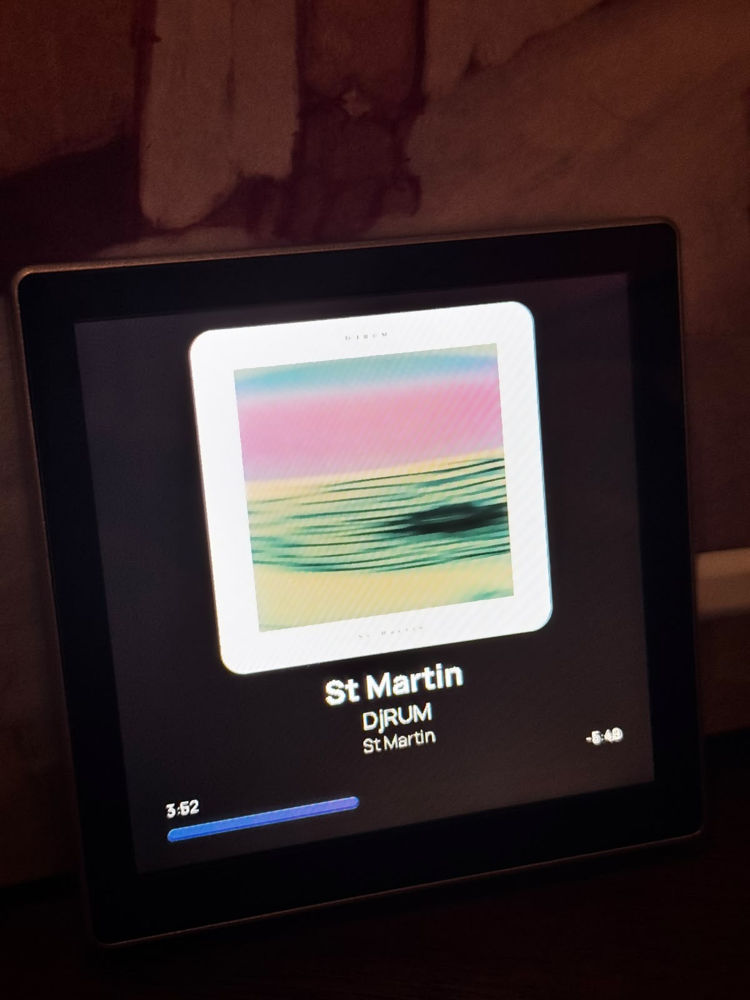
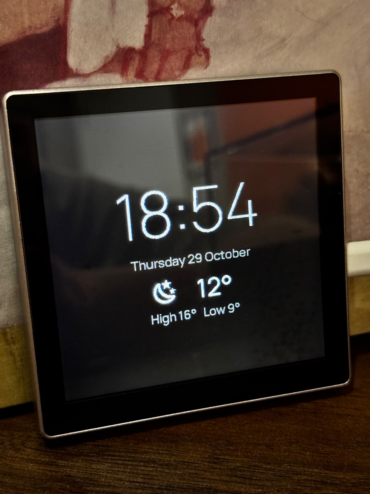
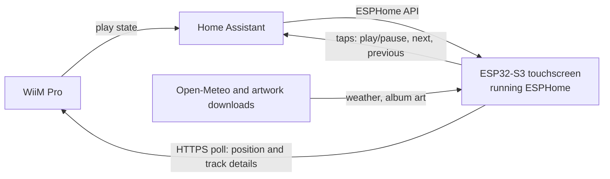

# Now playing display (ESP32 + ESPHome)

A small touchscreen (ESP32-S3-4848S040) that shows what's playing on a WiiM Pro: album art, title, artist, album and a live progress bar. When nothing is playing it turns into a clock with the weather.

The config is in [nowplaying.yaml](esphome/nowplaying.yaml).

<table>
  <tr>
    <td width="50%"></td>
    <td width="50%"></td>
  </tr>
</table>

## What it does

- Shows the album art, title, artist and album from the WiiM
- Progress bar with the time played on the left and the time remaining on the right. It reads the position straight from the WiiM, so scrubbing in Spotify shows up within about 10 seconds
- Dims and shows a pause icon while paused
- Idle screen with a clock, the date, the temperature with a weather icon, today's high and low and a line about rain only when rain is coming
- The idle screen is dimmed and the display goes fully dark from 1am to 6am (both are settings in the config)

Controls:

- One tap anywhere: play or pause. It waits 0.4 seconds to make sure it isn't a double tap
- Double tap on the right half: next track
- Double tap on the left half: previous track. If the song has been playing for a bit, the WiiM restarts it instead
- Triple tap on the left half: previous track twice, to go back a whole track
- A small arrow fades in over the artwork to show a double or triple tap was recognised
- On the idle screen, double tap to turn the display off until something plays
- On a dark screen, one tap wakes the clock. Overnight it goes dark again after 30 seconds

What it can't do:

- Seek by touch. I tried a scrub bar but the touch accuracy near the edges wasn't good enough
- Show much for sources that don't give the WiiM a title or artwork. I've only tested Spotify
- Change track instantly. There is a delay of a few seconds, see Problems I hit

## Why

When I play vinyl I always prop the sleeve up for whatever is playing, like a lot of people do. When I stream through the WiiM it felt like something was missing. I wasn't going to pay about £350 for the WiiM Ultra just for its small now playing screen, so I built my own. The board from AliExpress already came with a screen, and the touch controls were a bonus.

To me the artwork is as much a part of an album as the music. When I build my own hi-fi cabinet I can set the screen in flush for a polished look. And when I'm not listening to music I get a clock and weather screen, or anything else I want to put on it.

## How it works



- Home Assistant tells the display whether the WiiM is playing, paused or stopped
- The display asks the WiiM directly for the live position and track length every 10 seconds while the artwork is showing. Home Assistant's own position can lag badly after a seek in Spotify
- When the track changes, the display also fetches the title, artist, album and artwork address from the WiiM. If that stops working it falls back to Home Assistant's version
- Taps become Home Assistant actions (play/pause, next and previous) sent to the WiiM
- The weather comes from Open-Meteo every 30 minutes, and only while the clock is showing, so it can't cause stutter during music
- Rain is flagged when any hour in the next 24 has a 50% chance or more

## Hardware

- Guition ESP32-S3-4848S040 (4 inch, 480x480, capacitive touch). I bought mine from AliExpress (https://www.aliexpress.com/item/1005008214679682.html)
- A USB-A to USB-C data cable. Manual says not to use C to C
- A stable 5V 1A (or better) USB power supply
- A WiiM streamer. I used the WiiM Pro.

## Tech

| Area | What |
| --- | --- |
| Board | Guition ESP32-S3-4848S040 (4 inch, 480x480, capacitive touch) |
| Firmware | ESPHome with the ESP-IDF framework, tested on 2026.9.1 |
| Graphics | LVGL, built by ESPHome |
| Data | The WiiM's local web interface over HTTPS (`getPlayerStatus` and `getMetaInfo`) and the Home Assistant media player |
| Weather | Open-Meteo, no account or key needed |
| Icons and fonts | Material Design Icons for the weather, Manrope through Google Fonts |
| Controls | Touch taps become Home Assistant media player actions |

## Repo layout

<details>
<summary>Show the folder layout</summary>

```
esphome/         the ESPHome config (nowplaying.yaml) and secrets.yaml.example
docs/images/     photos
```

</details>

## Warnings

- The WiiM only accepts HTTPS and its certificate is self-signed, so the config has `verify_ssl: false`. That switches off certificate checking for every request the display makes, including the weather and artwork downloads
- Power it from a stable 5V 1A supply. The maker's manual says to use a USB-A to USB-C cable and not C to C

## Setup

<details>
<summary>Show the setup steps</summary>

### Before you start

- You'll need Home Assistant running with the WiiM integration, so the WiiM shows up as a media_player. If you haven't got it, start with the official guide: https://www.home-assistant.io/installation/
- You'll need ESPHome, either the dashboard or the add-on: https://esphome.io. I used 2026.9.1
- You'll need a 2.4 GHz Wi-Fi network. The ESP32 can't join 5 GHz
- The machine that compiles needs internet access, because the fonts are fetched from Google Fonts. The display needs it too for the weather and artwork
- I run Home Assistant and ESPHome in Docker on a home server. How you install them doesn't matter for this guide

### Home Assistant

- Find your WiiM's entity id. The config uses `media_player.wiim_pro_2`, so find and replace that with yours
- Give the WiiM a fixed IP address. I did it in the WiiM app by setting a manual IP in the device settings
- Create a text helper: Settings > Devices & services > Helpers > Create helper > Text. Name it `wiim_ip` so the entity is `input_text.wiim_ip`
- Put the WiiM's IP address in the helper, just the numbers and no http://. The display reads it from there, so if the address ever changes you edit the helper and don't have to reflash
- Once the display shows up in Home Assistant, go to Settings > Devices & services > ESPHome, open the cog on the device and tick "Allow the device to perform Home Assistant actions". Without it the taps do nothing

### Secrets

- nowplaying.yaml reads its passwords from a secrets.yaml file that is not in this repo
- Create one next to nowplaying.yaml, or add these to the one you already have:

```yaml
nowplaying_wifi_ssid: "your Wi-Fi name"
nowplaying_wifi_password: "your Wi-Fi password"
nowplaying_ap_password: "a password for the fallback hotspot"
nowplaying_api_key: "a 32 byte base64 key"
weather_api_url: "https://api.open-meteo.com/v1/forecast?latitude=YOUR_LATITUDE&longitude=YOUR_LONGITUDE&current=temperature_2m,precipitation,weather_code,is_day&daily=temperature_2m_max,temperature_2m_min&hourly=precipitation_probability&timezone=Europe%2FLondon&forecast_days=2"
```

- You can make a key with `openssl rand -base64 32`, or let ESPHome generate one when you create a device
- The same keys are in `esphome/secrets.yaml.example`, ready to copy

### Icon font

- The weather icons come from the Material Design Icons font
- Download it once into a folder called fonts, next to nowplaying.yaml:

```bash
mkdir -p fonts && curl -L -o fonts/materialdesignicons-webfont.ttf https://cdn.jsdelivr.net/npm/@mdi/font@7.4.47/fonts/materialdesignicons-webfont.ttf
```

- If ESPHome runs in a container, make sure the file ends up in the config folder that is mounted into it

### Flashing the display

- In the ESPHome dashboard, create a new device and pick ESP32-S3
- For the first flash, choose Install > Manual download > factory format (.bin)
- Open https://web.esphome.io in Chrome or Edge on a computer, press Connect, then Install and pick the .bin file. Phone browsers can't flash over USB
- After that, you can update over Wi-Fi with Install > Wirelessly
- Paste in the contents of [nowplaying.yaml](esphome/nowplaying.yaml) (updated to your liking) and install it
- The first compile takes a few minutes because it downloads the fonts and builds the graphics library

### First test

- The clock should appear once the display has the time from Home Assistant. The weather follows within a minute or so
- Start something playing on the WiiM. The artwork should appear within a few seconds
- Tap once to pause and again to resume
- If nothing happens when you tap, check the "Allow the device to perform Home Assistant actions" tick

</details>

## Configuration

<details>
<summary>Show the settings</summary>

### Edit the config

- Set your own latitude and longitude in `weather_api_url` in your secrets.yaml. The timezone is in the same address (`Europe%2FLondon`)
- The quiet hours are in the update_display script: `t.hour >= 1 && t.hour < 6`
- The idle brightness is the `brightness:` value on the idle screen branch of update_display. I found 20% too dim in daylight and went higher
- How often the WiiM is polled is `interval: 10s` in the interval section

### How the config works

- Every tap adds to a counter. A script waits 0.4 seconds, then works out whether it was a single, double or triple tap and which half of the screen it was on
- The two halves are invisible boxes. The left one is 112 wide and the right one is 368 wide, in the touch coordinates this board reports (see Problems I hit)
- The WiiM is asked for `getPlayerStatus` (position, length and a hex coded title that is used to spot track changes) and `getMetaInfo` (title, artist, album and artwork address) on its local web interface
- Between polls a 1 second timer counts the progress bar forward, then the next poll corrects it
- The weather code from Open-Meteo is mapped to a Material Design Icons glyph, with day and night versions of clear and partly cloudy
- For Spotify the artwork address is swapped for the 300 pixel version so it downloads faster
- The full config is in [nowplaying.yaml](esphome/nowplaying.yaml)

</details>

## Problems I hit

- A small stutter on every poll. The secure request to the WiiM briefly stalls the display, so a scrolling title can hitch every 10 seconds. Polling every 2 or 3 seconds was worse. A longer interval means fewer hitches but slower updates after a seek or track change
- The WiiM refuses plain HTTP, so there's no way round the secure request
- Touch coordinates are squashed. On my board the touch controller reports x values up to about 224 instead of 480, so the left and right zones are sized to match. A different board might report different numbers. If taps land in the wrong half, change the two zone widths
- The artwork can arrive a few seconds after the title. Most of that is download and decode time
- The artwork trick only works for Spotify. Other sources use the address as it is
- The fonts only include Latin characters, so titles in other alphabets will probably show gaps. I haven't tried it
- The backlight uses gamma correction, so low percentages look much darker than you'd expect
- ESPHome warns about GPIO19 and 20 (they double as the chip's native USB pins) and about accented glyphs missing from the fonts. Neither affects anything
- The USB log is silent by default. The USB-C port goes to a CH340 chip, but ESPHome sends its logs to the chip's native USB pins. Logs over Wi-Fi work fine. Adding `hardware_uart: UART0` under `logger:` should send them out of the USB-C port, but I haven't tried it

## Privacy

- Passwords, keys and the weather address (which holds your location) are not in this repo. Copy `esphome/secrets.yaml.example` to `secrets.yaml` and fill in your own.
- The weather request sends your latitude and longitude to Open-Meteo.

## Credits

This builds on other people's work:

- The ESPHome device page for the board, for the display and touch settings: https://devices.esphome.io/devices/guition-esp32-s3-4848s040
- Open-Meteo, for the weather: https://open-meteo.com
- Material Design Icons, for the weather icons: https://pictogrammers.com/library/mdi/
- Manrope, loaded through Google Fonts: https://fonts.google.com/specimen/Manrope
- A WiiM Home forum thread about showing what's playing on a Pimoroni Presto, which showed the metadata call: https://forum.wiimhome.com/threads/using-the-pimoroni-presto-to-display-whats-playing.6208
- I wrote the config with a lot of help from Claude (Anthropic), testing each version on the real display

## Known limits and next steps

Confirmed on my setup:

- Album art, title, artist and album show correctly for Spotify played through a WiiM Pro
- Single, double and triple tap controls work
- Scrubbing in Spotify updates the progress bar within the polling interval
- The clock and weather screen, the rain flag and the overnight blackout work

Not confirmed:

- Other WiiM models
- Other boards, or ESPHome versions other than 2026.9.1

## Disclaimer

This is a hobby project and I'm not affiliated with Guition, WiiM, Spotify or Open-Meteo. You use it at your own risk.

## Licence

This project is under the MIT License. See the [LICENCE](LICENCE) file.
